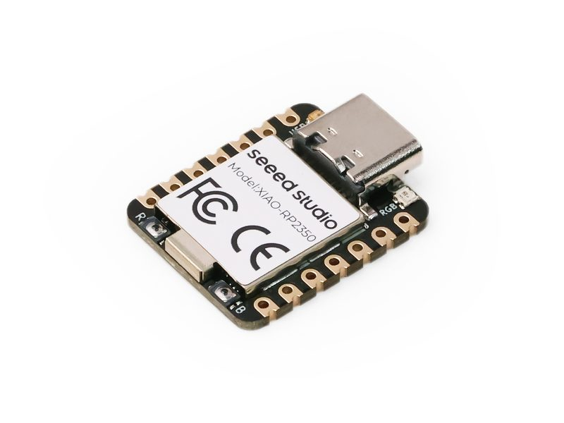

# Seeed XIAO RP2350 (Sense Node Mainboard)

[中文文档](README.zh.md) | [English](README.md)

[](https://github.com/Mi-Bee-Studio/seeed-xiao-rp2350/actions/workflows/build.yml)



A board under the board-centric repo convention. **This repo is organized with the board as root:**

```
seeed-xiao-rp2350/
├── README.md          # this file: all hardware info for this board
└── <project>/         # one directory per project built on this board (named by capability)
    ├── CMakeLists.txt / main/ / pico_sdk_import.cmake 
    └── README.md      # project description + build/flash commands
```

Key points of the convention:

- **Board directory name** = board name (kebab-case); the root README covers hardware only, never project content;
- **Each project directory builds standalone**: it ships its full build trio; `cd <project> && cmake -B build && cmake --build build` produces the firmware;
- Projects share no code; when commonality is needed, copy first, and consider extracting a shared component only once things stabilize.

### Firmware baseline norms (mandatory fleet-wide)

1. **Watchdog: mandatory.** enable the RP2350 on-chip hardware watchdog (`watchdog_enable`) and feed it from the main loop;
2. **Web/API firmware upgrade (OTA): mandatory where the hardware allows.** this board has **no radio at all**, so web/API OTA is hardware-exempt — upgrades go via UF2 (BOOTSEL / picotool / 1200bps soft-reboot).

| Project | Watchdog | Web/API OTA |
|---------|----------|-------------|
| blink | ✅ hardware watchdog (`watchdog_enable(8000,1)`) | N/A (no network; UF2/picotool is the path) |

---

## Board Overview

| Item | Value |
|------|-------|
| Chip | Raspberry Pi **RP2350A** — dual-core Arm Cortex-M33 @150 MHz (FPU, TrustZone/secure boot) |
| Flash | **2 MB external QSPI** (dedicated bus, not GPIOs) |
| SRAM | 520 KB on-chip (no PSRAM) |
| Wireless | **None** (pure USB device board; networking needs an external companion) |
| USB | Native USB Type-C (serial only when firmware enables CDC; **in BOOTSEL mode it is a USB drive, not a serial port**) |
| Onboard LED | **USER LED = GPIO25** (yellow, **active-low**); **WS2812 RGB = GPIO22** (power-enable GPIO23) |
| Buttons | BOOT (enters UF2 download mode, **not a GPIO**), RESET (silkscreen B) |
| Debug | Back-side pad group above the USB-C: **CLK(SWCLK) · DIO(SWDIO) · GND · RST · BOOT · 3V3** (openocd/Picoprobe) |
| Dimensions | 21 × 17.8 mm (standard XIAO form factor) |
| SDK | Official **pico-sdk** (C/C++); this repo builds with `-DPICO_BOARD=seeed_xiao_rp2350` (official board header) |

## Pinout Diagram (USB-C pointing up, front/component-side view; D numbers = XIAO silkscreen)

```
                 ┌─ USB-C ─┐
       5V ◎┬───┘          ├───┬◎ D0/A0 = GPIO26 (ADC)
      GND ◎│              │   ◎ D1/A1 = GPIO27 (ADC)
      3V3 ◎│ [USER LED]   │   ◎ D2/A2 = GPIO28 (ADC)
     D3 ◎  │  = GPIO25    │   ◎ D4 = GPIO6  (I2C1 SDA)
     D5 ◎  │  [WS2812=22] │   ◎ D5 = GPIO7  (I2C1 SCL)
    D10 ◎  │  [BOOT][RST] │   ◎ D6 = GPIO0  (UART0 TX)
           │   RP2350A    │   ◎ D7 = GPIO1  (UART0 RX)
           └──────────────┘   ◎ D3 = GPIO5  (SPI0 CSn)
            left row (front)  right row (front)

  Second row (back/edge, D11–D18): D11=GPIO21(RX1) · D12=GPIO20(TX1) ·
  D13=GPIO17(SCL0) · D14=GPIO16(SDA0) · D15=GPIO11(SPI1_MOSI) ·
  D16=GPIO12(SPI1_MISO) · D17=GPIO10(SPI1_SCK) · D18=GPIO9(SPI1_CSn)
  Battery sense: ADC_BAT=GPIO29 (1:1 divider, reading ×2) · enable=GPIO19
```

Key points (pin mapping per the [Seeed wiki](https://wiki.seeedstudio.com/getting-started-xiao-rp2350/) and the official pico-sdk board header `seeed_xiao_rp2350.h`):

- **Left row** (downward from USB): `5V · GND · 3V3 · D3=GPIO5(SPI0 CSn) · D5=GPIO7(I2C1 SCL) · D10=GPIO3(SPI0 MOSI)` — D4/D8/D9 sit on the right row per the official diagram;
- **Right row** (downward from USB): `D0/A0=GPIO26 · D1/A1=GPIO27 · D2/A2=GPIO28 · D4=GPIO6(SDA1) · D8=GPIO2(SPI0 SCK) · D9=GPIO4(SPI0 MISO) · D6=GPIO0(TX0) · D7=GPIO1(RX0)`;
- RP2040-family peripherals route through a **full mux matrix** (PIO synthesizes arbitrary timing) — no ESP-style fixed alternate-function table;
- GPIO22=WS2812, GPIO23=WS2812 power enable, GPIO25=USER LED — reserved by onboard parts, do not repurpose.

## Caveats

- **Download mode is completely different from ESP**: hold BOOT while plugging USB (or hold BOOT + tap RESET while running) to enter BOOTSEL, which enumerates as the `RP2350` mass-storage drive — drag a UF2 to flash;
- **Hands-free flashing**: pico-sdk by default soft-reboots into BOOTSEL when the CDC port is opened at **1200 baud** (verified with this repo's blink);
- **USER LED is active-low** — invert the drive logic;
- GPIO23 gates the WS2812 power — drive it high before using the RGB;
- No radio, no PSRAM: networking / large-buffer needs require an external companion or a different board.

## Project Index

| Project | Description |
|---------|-------------|
| [blink](blink/README.md) | Baseline/test firmware: USER LED (GPIO25) heartbeat + hardware watchdog + USB CDC heartbeat log (**verified on real hardware**, 2026-10-01) |
